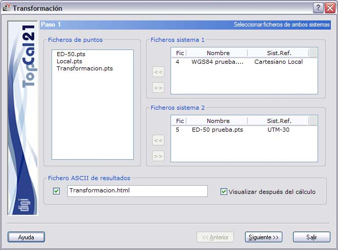

# Paso 1: Seleccionar ficheros de ambos sistemas
<!-- id: topcal21-transformacion-paso-1-seleccionar-ficheros-de-ambos-sistemas -->

Este es el primer paso para calcular la transformación. Los datos requeridos son los siguientes:

* **Ficheros de puntos**: Se seleccionarán los ficheros de puntos del proyecto que se desean utilizar en la transformación. Con los botones **>>** situados en la parte derecha del cuadro se deberá seleccionar qué ficheros forman parte del sistema de coordenadas 1 y qué ficheros forman parte del sistema de coordenadas 2.
* **Ficheros sistema 1**: Estos ficheros contienen los puntos comunes necesarios para transformar los puntos del sistema 2 a dicho sistema.
* **Ficheros sistema 2**: Estos ficheros contienen los puntos comunes necesarios para transformar los puntos no comunes de estos ficheros al sistema 1.
* **Ficheros de resultados**: Se escribirá el nombre del fichero de salida con los resultados del cálculo. Este archivo podrá ser del formato **html** o de formato **ASCII**. Si la extensión de este archivo es HTM o html se tomará como formato html y en caso contrario se tomará como formato ASCII. Este archivo se podrá visualizar (con el visor que se hubiese indicado en el cuadro de [Preferencias](../../opciones-de-visualizacion/preferencias.md) del menú [Editar](../../menus-de-la-aplicacion/menu-editar.md)) si se activa la casilla inferior denominada **Visualizar después del cálculo**. Si no se desea crear este archivo, se deberá desactivar la casilla que aparece a la izquierda del nombre. El archivo se creará en el directorio del proyecto.

Una vez introducidos estos datos se podrá pulsar el botón **Siguiente** para acceder al [Paso 2: Puntos comunes a ambos sistemas](paso-2-puntos-comunes-a-ambos-sistemas.md).
