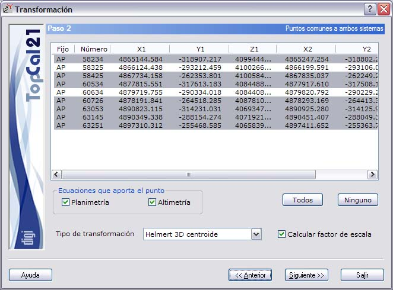

# Paso 2: Puntos comunes a ambos sistemas
<!-- id: topcal21-transformacion-paso-2-puntos-comunes-a-ambos-sistemas -->

Este es el segundo paso para el cálculo de la transformación.

Se muestra una pantalla con los puntos comunes a ambos sistemas, pertenecientes a los ficheros de puntos seleccionados en el *Paso 1*. Se deberán seleccionar los puntos con los cuales se realizará la transformación.

En la parte inferior del cuadro de diálogo se indica el tipo de transformación que se realizará:

* **Helmert 2 dimensiones**: Los giros y traslaciones son calculados desde el origen de coordenadas. Las incógnitas del sistema son cuatro y cada punto aporta dos ecuaciones al sistema.
* **Helmert 3 dimensiones**: Los giros y traslaciones son calculados desde el origen de coordenadas. Las incógnitas del sistema son siete y cada punto aporta tres ecuaciones al sistema.
* **Helmert 2 dimensiones utilizando centroide**: Se calculan los centros de masas de los dos sistemas, siendo las traslaciones la diferencia entre ambos puntos y los giros referidos a éstos. Las incógnitas del sistema son cuatro y cada punto aporta dos ecuaciones al sistema.
* **Helmert 3 dimensiones utilizando centroide**: Se calculan los centros de masas de los dos sistemas, siendo las traslaciones la diferencia entre ambos puntos y los giros referidos a éstos. Las incógnitas del sistema son siete y cada punto aporta tres ecuaciones al sistema.
* **Afín 2 dimensiones**: Los giros y traslaciones son calculados desde el origen de coordenadas. Las incógnitas del sistema son seis y cada punto aporta dos ecuaciones al sistema.
* **Afín 2 dimensiones utilizando centroide**: Se calculan los centros de masas de los dos sistemas, siendo las traslaciones la diferencia entre ambos puntos y los giros referidos a éstos. Las incógnitas del sistema son seis y cada punto aporta dos ecuaciones al sistema.
* **Traslación XY**: Únicamente se calcula la traslación planimétrica. Las incógnitas del sistema son dos y cada punto aporta dos ecuaciones.
* **Traslación Z**: Únicamente se calcula la traslación altimétrica. Hay una incógnita en el sistema y cada punto aporta una ecuación.
* **Traslación 3D**: Se calcula la traslación en el espacio. Las incógnitas del sistema son tres y cada punto aporta tres ecuaciones.

Si el tipo de transformación elegido es 3 dimensiones, el programa permitirá al usuario seleccionar qué puntos aportan ecuaciones en planimetría y altimetría. Para ello se muestran dos casillas en parte inferior del cuadro de diálogo que se podrán activar o desactivar teniendo seleccionados los puntos que se desean modificar.

En este tipo de transformación, se mostrará en el listado un campo más a la izquierda que indicará qué ecuaciones aporta cada punto: Si aparece una letra **P**, el punto aportará ecuaciones en planimetría; si aparece una letra **A**, el punto aportará ecuaciones en altimetría.

La utilidad de esta selección de ecuaciones reside en la posibilidad de eliminar del sistema aquellas coordenadas que aportan demasiado error en el cálculo.

Además, existe otra casilla en el cuadro de diálogo que permitirá al usuario seleccionar la posibilidad de incluir o no en el sistema la incógnita factor de escala.

El listado que se muestra contiene los siguientes campos:

* **Número de punto**
* **Coordenadas en el sistema 1**
* **Coordenadas en el sistema 2**

En función del tipo de transformación que se haya elegido, se mostrarán las coordenadas XY (2 dimensiones), la coordenadas Z (traslación altimétrica) o XYZ (3 dimensiones) en ambos sistemas.

Se podrán seleccionar múltiples puntos utilizando la tecla *\[CTRL\]* y pulsando con el botón izquierdo del ratón sobre los puntos deseados. Si se pulsa sobre un punto ya seleccionado, éste se deselecciona.

También se pueden seleccionar puntos dispuestos en rangos, pulsando la tecla *\[MAYÚSCULAS\]* y el botón izquierdo del ratón sobre los puntos límite que definen el rango.

De la misma forma, se pueden utilizar los botones de **Todos** o **Ninguno** para seleccionar o deseleccionar todos los puntos.

Cuando se hayan seleccionado los puntos deseados se puede pulsar al botón **Siguiente** para acceder al [Paso 3: Residuos](paso-3-puntos-transformados-y-residuos.md) o volver al [Paso 1: Seleccionar ficheros de ambos sistemas](paso-1-seleccionar-ficheros-de-ambos-sistemas.md) pulsando el botón **Anterior**.
