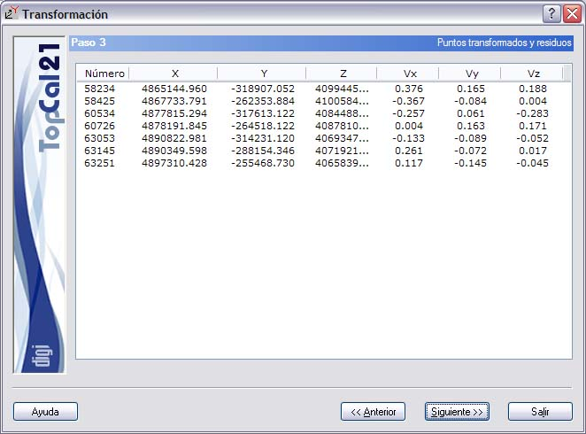

# Paso 3: Residuos
<!-- id: topcal21-transformacion-paso-3-residuos -->

Este es el tercer paso para el cálculo de la transformación.

Se muestra una pantalla con los puntos comunes transformados. El listado que se muestra contiene los siguientes campos:

* **Número de punto**
* **Residuos** de las coordenadas de los puntos comunes transformados. Las características de estos residuos están en función del tipo de transformación que se haya elegido en el [Paso 2](paso-2-puntos-comunes-a-ambos-sistemas.md), es decir, si se eligió una transformación en 2 dimensiones sólo aparecerán los residuos de las coordenadas planimétricas y la componente cuadrática del residuo en X e Y; si se eligió una transformación en 3 dimensiones además aparecerá el residuo en la cota y la componente cuadrática de los tres residuos; pero si se eligió una traslación altimétrica sólo aparecerá el residuo en la cota.

Pulsando sobre la cabecera de este listado es posible ordenar de forma ascendente o descendente según la columna pulsada.

Si algún punto tuviera un residuo demasiado alto, en función de las características y objetivo de la transformación, sería adecuado, si fuera posible, desestimarlo para el cálculo, para lo cual se debería volver al paso anterior y deseleccionarlo. Para ayudar a este cometido el programa marcará con un asterisco aquel residuo que supere 2.5 veces la desviación típica del sistema, es decir, que es erróneo a un 99% de probabilidad.

Una vez aceptados los datos mostrados se puede pulsar al botón **Siguiente** para acceder al [Paso 4: Parámetros de la transformación](paso-4-parametros-de-la-transformacion.md) o volver al [Paso 2: Puntos comunes a ambos sistemas](paso-2-puntos-comunes-a-ambos-sistemas.md) pulsando el botón **Anterior**.
