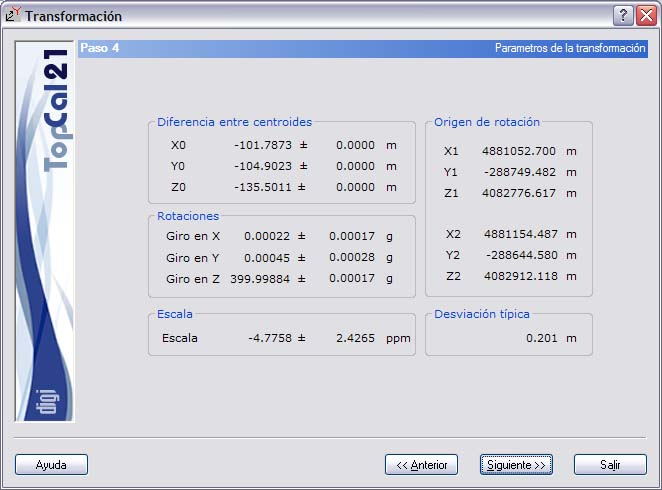

# Paso 4: Parámetros de la transformación
<!-- id: topcal21-transformacion-paso-4-parametros-de-la-transformacion -->

Este es el cuarto paso para el cálculo de la transformación.

Se muestra una pantalla con los parámetros de transformación que serán variables en función del tipo de transformación seleccionada pero que, de forma general, son:

* **Desplazamiento** o **diferencia entre centroides**
* **Origen de la rotación**: Sólo si se ha elegido calcular la transformación utilizando centros de masas
* **Rotaciones**: Mostrados en grados centesimales
* **Factor de escala**: Mostrado en partes por millón
* **Desviación típica** de la transformación

Si la transformación seleccionada fue Helmert 2D, los desplazamientos sólo se refieren a las coordenadas XY y sólo se muestra un giro y un factor de escala.

Si la transformación seleccionada fue Helmert 3D, los desplazamientos se refieren a las tres coordenadas XYZ, habrá un giro por cada uno de los ejes y sólo un factor de escala.

Si la transformación seleccionada fue Afín 2D, los desplazamientos sólo se refieren a las coordenadas XY y se muestra el giro y factor de escala por cada eje.

Cada uno de los parámetros calculados viene acompañado de la precisión con la que fue calculado.

Estos parámetros podrán ser **salvados a disco**, en un archivo ASCII para aplicarlos después a los puntos de otro fichero. Para utilizar estos parámetros sobre otro fichero se podrá utilizar la herramienta [Transformación Helmert/Afín de coordenadas](../../calculos/transformacion-helmert-de-coordenadas/README.md) del menú [Cálculos](../../menus-de-la-aplicacion/menu-calculos.md).

Una vez aceptados los datos mostrados se puede pulsar al botón **Siguiente** para acceder al [Paso 5: Puntos transformados y salida de datos](paso-5-puntos-transformados-y-salida-de-datos.md) o volver al [Paso 3: Residuos](paso-3-puntos-transformados-y-residuos.md) pulsando el botón **Anterior**.
