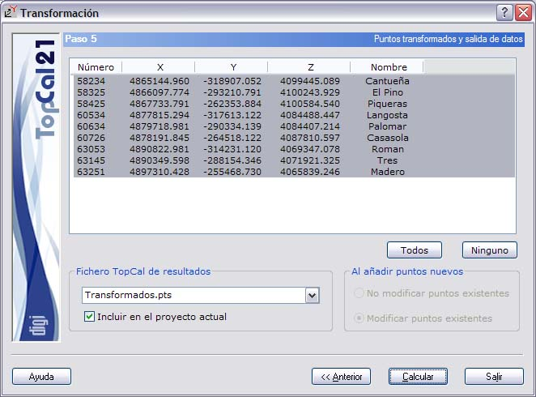

# Paso 5: Puntos transformados y salida de datos
<!-- id: topcal21-transformacion-paso-5-puntos-transformados-y-salida-de-datos -->

Este es el quinto y último paso en el cálculo de la transformación.

Se muestran los siguientes campos:

* **Listado de puntos no comunes transformados**: Se muestra un listado del resto de puntos pertenecientes al sistema 2, con las coordenadas referidas y ya transformadas al sistema 1. En este listado, es posible seleccionar los puntos que serán transformados y almacenados.
* **Fichero TopCal de resultados**: Se podrá seleccionar el nombre del fichero TopCal donde se almacenarán los puntos. Se podrá elegir alguno de los archivos existentes o generar un archivo nuevo. Si se desea generar un archivo nuevo, se podrá elegir añadir o no el fichero al proyecto actual.
* **Modo de añadir puntos**: Si el fichero de puntos no es nuevo se podrá elegir modificar o no los puntos con el mismo número que se encuentren en el fichero de salida elegido.

Una vez que se hayan configurado los datos de salida, se podrá terminar el proceso pulsando el botón **Calcular** o volver al paso anterior [Paso 4: Parámetros de la transformación](paso-4-parametros-de-la-transformacion.md) pulsando el botón **Anterior**.
