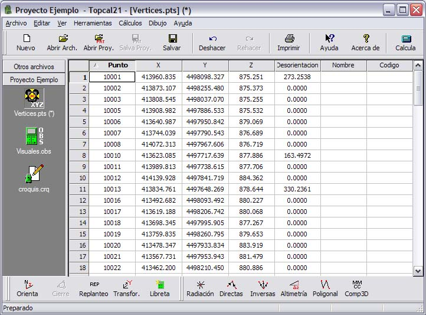
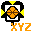
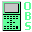
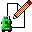
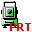

# Interfaz de usuario
<!-- id: topcal21-interfaz-de-usuario -->

El programa muestra una pantalla dividida en dos partes diferenciadas: una, a la izquierda, que muestra los ficheros y proyectos abiertos; y otra, a la derecha, que muestra el contenido de los archivos en forma de hoja de cálculo.

Asimismo, se muestran barras de herramientas en la parte inferior y superior, aunque éstas son movibles, con los comandos principales del programa, que ayudarán al usuario en su ejecución.

La hoja de cálculo que muestra el contenido de los archivos permite al usuario la introducción manual de datos. Además, permite elegir qué datos se desean ver de cada archivo y forma de ordenación. Los datos mostrados para cada tipo de fichero son diferentes. Para introducir datos sólo tiene que elegir la celda a modificar mediante el cursor del teclado o el ratón y escribir directamente el valor. Si se quiere modificar un valor existente debe pulsar primero la tecla *ENTER* para empezar a editar. Si se desea introducir un valor con decimales, el carácter que delimita dichos dígitos es el punto. Las unidades en que se deben introducir los valores están expresadas en la definición del archivo pudiendo ser de metros o pies para las unidades lineales, y centesimal, sexagesimal o sexagesimal pseudodecimal para las unidades angulares. Si desea cambiar las unidades del archivo actual deberá acudir a las propiedades del archivo. Para más información consulte alguno de los siguientes apartados en función del tipo de archivo: [puntos](../opciones-de-visualizacion/propiedades-de-los-objetos/propiedades-del-archivo-de-puntos.md) u [observaciones](../opciones-de-visualizacion/propiedades-de-los-objetos/propiedades-del-archivo-de-visuales.md).

Para introducir ángulos en formato pseudodecimal, introduzca los grados, un punto decimal, dos dígitos para los minutos, dos dígitos para los segundos y los decimales de los segundos. Por ejemplo, el ángulo 90 grados 38 minutos 45.67 segundos se introduce como 90.384567.

Por defecto, los archivos de puntos son ordenados de forma ascendente por el *Número de punto* y los archivos de observaciones por el *Número de estación* y por el *Número de visado*. Si se desea ordenar el fichero por otro campo, se puede pulsar sobre la cabecera de dicho campo, ordenándose inicialmente de forma ascendente. Si se vuelve a pulsar otra vez sobre el mismo campo, se ordenará de forma descendente.

Es posible también ordenar los datos acudiendo a la orden [Ordenar datos](../opciones-de-visualizacion/ordenar-datos.md) del menú [Ver](../menus-de-la-aplicacion/menu-ver.md).

Es posible borrar registros, seleccionando todo el registro y pulsando la tecla **Suprimir** o pulsando el botón derecho del ratón sobre el registro y seleccionando el comando **Borrar registro**. TopCal 21 también considera un registro como borrado si su identificador está a cero. Esto significa que no podrá haber punto con *Número de punto* igual a cero ni ninguna visual con *Número de estación* o *Número de visado* a cero.

Si un registro está borrado el programa lo seguirá mostrando pero en color rojo, si esta opción fue activada en el cuadro de diálogo [Preferencias](../opciones-de-visualizacion/preferencias.md) del [Menú Editar](../menus-de-la-aplicacion/menu-editar.md). Asimismo, es posible recuperar registros pulsando el botón derecho del ratón sobre el registro borrado y seleccionando el comando **Recuperar registro**.

El programa también permite la múltiple selección de registros utilizando las teclas **CTRL** o **MAYÚSCULAS**, o pulsando con el botón izquierdo del ratón y sin soltarlo extendiendo una ventana sobre los registros que se desean seleccionar.

Esta forma de presentar los datos permite copiar, cortar y pegar datos entre diferentes ventanas o incluso entre diferentes programas. Por ello, puede seleccionar un conjunto de registros, cortarlos y pegarlos en Microsoft Excel para procesarlos. También puede pegar en TopCal 21 datos cortados o copiados en Excel.

Por otro lado, cuando se tiene activo un archivo de tipo croquis, el aspecto de la vista central del programa es el de una aplicación de dibujo y se activarán las barras de herramientas relacionadas con la edición de entidades de dibujo.

En este tipo de vista, la interacción del usuario con los elementos de dibujo mostrados se realiza a través del ratón del ordenador. Al mover el puntero del ratón dentro de la ventana del documento, la aplicación mostrará en la barra de estado las coordenadas de la posición del puntero.

Cuando un determinado comando precise de la selección de elementos ésta se deberá realizar con el botón izquierdo del ratón. Tras lo cual, el programa buscará entidades en el entorno donde actualmente se encuentra el cursor del ratón.

Si encuentra alguna entidad, ésta se iluminará de otro color y el programa pedirá que se confirme la selección para ejecutar la orden (pulsando nuevamente el botón izquierdo del ratón) o que se rechace esta selección para buscar más entidades en la misma zona (pulsando el botón derecho del ratón) o que se finalice la búsqueda (pulsando la tecla ESC).

Si el ratón dispone de rueda central, se puede utilizar para aumentar o reducir el zoom de la vista actual.

La estructuración de los datos topográficos en TopCal 21 es la siguiente:

* [ Ficheros de puntos](../estructura-de-archivos/ficheros-de-puntos.md): En estos ficheros se almacenarán las coordenadas de los puntos, sus desorientaciones y sus nombres y códigos si tienen. En todo cálculo topográfico se parte de las coordenadas conocidas de una serie de puntos y, mediante cálculos que utilizan visuales realizadas en campo, se obtienen las coordenadas de otros puntos.
* [ Ficheros de observaciones o visuales](../estructura-de-archivos/ficheros-de-visuales.md): En estos ficheros se almacenarán las observaciones realizadas con aparatos de topografía. Estas observaciones son utilizadas para calcular las coordenadas desconocidas de puntos. Están compuestas por un número de estación y de punto visado, un ángulo horizontal, un ángulo vertical, una distancia, una altura de instrumento, una altura de mira y un código, si éste fue registrado.
* [Ficheros de croquis o dibujo](../estructura-de-archivos/fichero-de-croquis.md): En estos ficheros se almacenan entidades geográficas que fueron tomadas en el momento de la recogida de puntos. De esta forma, se podrán relacionar puntos mediante líneas para representar elementos lineales o representar símbolos mediante puntos singulares. Este tipo de archivos sólo se generan dentro de proyectos y dependen de los archivos de puntos que representan, de tal forma que si éstos cambian, también lo hará el dibujo.
* [ Ficheros de proyectos](../estructura-de-archivos/fichero-de-proyecto.md): Estos ficheros contienen una relación de los ficheros anteriores referentes a un mismo tipo de trabajo. Cada fichero de proyecto crea una carpeta donde se almacenarán los ficheros. Se deberá crear un proyecto para cada trabajo. Teniendo activo el proyecto se podrán utilizar las principales herramientas de TopCal 21 como cálculo de poligonales, intersecciones, etc. En cada proyecto se podrán tener tantos archivos de puntos, visuales o croquis como se deseen.

TopCal 21 podrá tener tantos proyectos abiertos como se deseen. También podrá abrir archivos de puntos o visuales que no se encuentren en ningún proyecto determinado y se mostrarán en una carpeta llamada **Otros archivos**.

Las herramientas que incluye TopCal 21 se pueden utilizar en función del tipo de archivo o proyecto que esté seleccionado. Así, aquellas herramientas que necesiten de ficheros de puntos y de visuales para los cálculos necesitarán tener un proyecto activo. Pero otras herramientas sólo precisan de un archivo de puntos o de observaciones, por lo que no será necesario la creación de un proyecto.

Todas las herramientas o utilidades de TopCal 21 se encuentran distribuidas en sus diferentes menús que son:

* [Archivo](../menus-de-la-aplicacion/menu-archivo.md): Contiene todos los comandos de operaciones con archivos y de impresión
* [Editar](../menus-de-la-aplicacion/menu-editar.md): Aquí están reunidos los comandos referentes a la edición de los datos de la hoja de cálculo así como las opciones de visualización de dichos datos. También contiene las herramientas para la gestión de sistemas de referencia e instrumentos topográficos
* [Ver](../menus-de-la-aplicacion/menu-ver.md): Contiene los comandos para la visualización de las barras de herramientas, iconos de los archivos y propiedades de los diferentes objetos
* [Herramientas](../menus-de-la-aplicacion/menu-herramientas.md): Aquí están las principales herramientas de cálculo topográfico que contiene el programa
* [Cálculos](../menus-de-la-aplicacion/menu-calculos.md): Aquí están reunidos los diversos cálculos geométricos que se pueden realizar con los puntos, así como operaciones con visuales, transformaciones de coordenadas, etc.
* [Dibujo](../menus-de-la-aplicacion/menu-dibujo.md): Contiene los diversos comandos útiles para la edición de los datos de croquis
* [Ayuda](../menus-de-la-aplicacion/menu-ayuda.md): Aquí están los comandos relacionados con la ayuda para la utilización de la aplicación y sus herramientas

En las barras de comandos se pueden encontrar los más comúnmente utilizados para una rápida ejecución. Los comandos incluidos en esta barra, muestran un icono representativo con la función. Sitúe el puntero del ratón sobre un icono para ver el nombre del comando asociado. Pulse el icono para ejecutar el comando. Las barras de herramientas incluidas son las siguientes:

* [MainTool](../barras-de-herramientas/barra-de-herramientas-maintool.md): Contiene los comandos generales del programa, como abrir, guardar o imprimir archivos o los comandos de ayuda
* [TopcalTool](../barras-de-herramientas/barra-de-herramientas-topcaltool.md): Contiene herramientas de cálculo topográfico básicas
* [Coordenadas](../barras-de-herramientas/barra-de-herramientas-coordenadas.md): Contiene las herramientas para calcular coordenadas de puntos, de las diversas formas que los métodos topográficos permiten
* [Dibujo](../barras-de-herramientas/barra-de-herramientas-dibujo.md): Incluye herramientas útiles para edición y gestión de los datos que contienen los archivos de croquis
* [Paleta](../barras-de-herramientas/barra-de-herramientas-paleta.md): Contiene herramientas de visualización o tratamiento de las entidades del archivo de croquis actual

En la barra de estado se mostrará información de la herramienta seleccionada, así como mensajes de petición del programa al usuario. Asimismo, cuando se tenga activo un archivo de croquis, se ofrecen las coordenadas en las que está el cursor.
