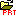

# Menú Archivo
<!-- id: menu-archivo -->

Este menú contiene todos los comandos de operaciones con archivos y de impresión. Los comandos contenidos son:

*  **[Nuevo](../estructura-de-archivos/crear-un-fichero-nuevo.md)**: Crea un documento nuevo: un proyecto o un archivo de puntos, visuales o croquis. A esta herramienta también se puede acceder con la combinación de teclas *Ctrl* + *N*.
*  **Abrir**: Abre un archivo de puntos o visuales existente y lo añade a la carpeta Otros archivos. A esta herramienta también se puede acceder con la combinación de teclas *Ctrl* + *A*.
*  **Guardar**: Guarda el documento actual. Si el documento no fue guardado antes, el programa abrirá el explorador de Windows para indicar un nombre y una carpeta de destino. Esta opción sólo estará activa si se modificó el documento. A esta herramienta también se puede acceder con la combinación de teclas *Ctrl* + *G*.
* **Guardar como**: Guarda el documento actual con un nombre o carpeta destino diferente a la actual. El programa abre el explorador de Windows para indicar el nombre y la carpeta de destino.
*  **Cerrar**: Cierra el documento actual. Esta opción sólo estará activa si se encuentra activo un elemento de la carpeta *Otros archivos*. Si se desea eliminar un archivo de un proyecto, se debería ejecutar el comando *Eliminar archivos*, descrito a continuación
*  **Abrir proyecto**: Abre un proyecto TopCal existente.
*  **Guardar proyecto**: Guarda el proyecto actual. Si el proyecto no fue guardado antes, el programa abrirá el explorador de Windows para indicar un nombre y una carpeta de destino. Esta opción sólo estará activa si se modificó el proyecto.
* **Guardar todo**: Guarda todos los archivos modificados y el proyecto si éste también lo fue. A esta herramienta también se puede acceder con la tecla *F2*.
* **Cerrar proyecto**: Cierra el proyecto actual. A esta herramienta también se puede acceder con la combinación de teclas *Ctrl* + *F4*.
*  **Insertar archivos**: Inserta un archivo de puntos u observaciones en el proyecto actual.
*  **Eliminar archivos**: Elimina un archivo de puntos, observaciones o croquis del proyecto actual. Sólo estará disponible si se tiene activo un proyecto.
* **Importar**: Para importar datos procedentes de otros tipos de archivos. Existen varios tipos en función del tipo de archivo donde se importarán los datos, es decir, archivo de puntos o de observaciones. Los archivos que importa TopCal 21, en función del tipo de archivo actual, son:
  * *Ficheros de puntos*:
    * Archivos de puntos de TopCal versión MS-DOS.
    * Archivos BIN de DIGI.
    * Archivos ASCII de DIGI.
    * Archivos DXF de AutoCad.
    * Archivos ASCII: Archivos de texto con diferentes datos colocados en columnas configurables. Estos archivos deberían contener una línea por cada registro, donde los diferentes campos podrán estar separados por espacios, comas o tabuladores. Si el nombre del punto contiene espacios, comas o tabuladores, escríbalo entre comillas dobles para que el programa no interprete esos caracteres como separadores de campos.
    * Archivos GSI de Leica.
    * Archivos procedentes de SDR.
    * Archivos de estaciones Nikkon.
    * Archivos ZAS de La Técnica.
    * Archivos DGN de MicroStation.
  * *Ficheros de observaciones*:
    * Archivos de visuales de TopCal versión MS-DOS.
    * Archivos ASCII: Archivos de texto con diferentes datos colocados en columnas configurables. Estos archivos deberían contener una línea por cada registro, donde los diferentes campos podrán estar separados por espacios, comas o tabuladores.
    * Archivos GSI de Leica.
    * Archivos de GeoRed.
    * Archivos procedentes de SDR.
    * Archivos de estaciones Kern.
    * Archivos GeoDat de Geodimeter.
    * Archivos de estaciones Nikkon.
    * Archivos de estaciones Topcon.
    * Archivos de estaciones Pentax.
    * Archivos procedentes de Psion.
    * Archivos procedentes de Psion para Sokkisa.
    * Archivos procedentes de Psion para GeoDat.
    * Archivos procedentes de Psion para Tacor.
    * Archivos ZAS de La Técnica.
    * Archivos de TCP ET.
* **Exportar**: Para exportar los datos del archivo actual. Existen varios formatos de destino, en función del tipo de archivo actual, es decir, archivo de puntos o de observaciones. Los archivos que exporta TopCal 21, en función del tipo de archivo actual, son:
  * *Ficheros de puntos*: TopCal 21 permite exportar los ficheros de puntos a formatos de equipos topográficos o archivos de dibujo (BIN, DXF, DGN). En este segundo caso, se puede [configurar la forma de traducción](../otros-comandos/exportar-puntos-a-un-archivo-de-dibujo.md) pulsando el botón **Avanzado** que aparece en el cuadro de diálogo.Los formatos contemplados son:
    * Archivos de puntos de TopCal versión MS-DOS.
    * Archivos BIN de DIGI.
    * Archivos ASCII de DIGI.
    * Archivos DXF de AutoCad.
    * Archivos DXF para AutoCad 2000.
    * Archivos ASCII: Archivos de texto con diferentes datos colocados en columnas configurables. Se generará una línea por cada registro y los campos de cada registro estarán separados por espacios.
    * Archivos html: Archivos de texto formateado con diferentes datos colocados en columnas configurables. El color de fondo de este archivo y la fuente de texto puede ser configurado desde el cuadro de diálogo de [Preferencias](../opciones-de-visualizacion/preferencias.md) en el menú [Editar](menu-editar.md).
    * Archivos GeoDat para estaciones Geodimeter.
    * Archivos GSI para estaciones Leica. Se podrá indicar si se quieren exportar los datos con 16 posiciones. Si no, se exportarán los datos con 8 posiciones.
    * Archivos ZAS de La Técnica.
    * Archivos DGN de MicroStation.
  * *Ficheros de observaciones*:
    * Archivos de visuales de TopCal versión MS-DOS.
    * Archivos ASCII: Archivos de texto con diferentes datos colocados en columnas configurables. Se generará una línea por cada registro y los campos de cada registro estarán separados por espacios.
    * Archivos html: Archivos de texto formateado con diferentes datos colocados en columnas configurables. El color de fondo de este archivo y la fuente de texto puede ser configurado desde el cuadro de diálogo de [Preferencias](../opciones-de-visualizacion/preferencias.md) en el menú [Editar](menu-editar.md).
    * Archivos GeoDat para estaciones Geodimeter.
  * *Ficheros de croquis*: Cuando se exporta un fichero de croquis se debe indicar el denominador de la escala para calcular el tamaño de textos y símbolos en coordenadas terreno. El tamaño de textos y la información que aparece por cada punto se puede configurar en la opción [Preferencias de croquis](../opciones-de-visualizacion/preferencias-de-croquis.md). Además, se podrá indicar si se quiere traducir los símbolos como tales o como simples puntos.
    * Archivos BIN de DIGI.
    * Archivos ASCII de DIGI.
    * Archivos DXF de AutoCad: Se podrá indicar si se quiere traducir en 2 dimensiones, es decir, sin utilizar la cota de los elementos.
    * Archivos DXF para AutoCad 2000: Igualmente se podrá indicar si se quiere traducir en 2 dimensiones.
    * Archivos DGN de MicroStation: En este caso, el programa pedirá que se indique el nombre del archivo que actuará de semilla y, si se tiene, una tabla de traducción de los códigos TopCal al sistema de codificación de MicroStation (nivel, estilo, color, peso y grupo gráfico)
*  **Agregar archivo**: Une archivos existentes al actual. Solamente se podrán agregar archivos del mismo tipo que el archivo actual, es decir, a un archivo de puntos sólo se le pueden agregar archivos de puntos y a los archivos de observaciones, únicamente este tipo de archivos. El programa abrirá el explorador de Windows para seleccionar los archivos a agregar. En este cuadro de diálogo se podrá seleccionar un solo archivo o varios, utilizando las teclas Mayúsculas y Control.
*  **Imprimir**: Imprime el documento actual. A esta herramienta también se puede acceder con la combinación de teclas *Ctrl* + *I*.
* **Presentación preliminar**: Muestra en pantalla cómo se imprimiría el documento actual.
* **Configurar impresora**: Configura el dispositivo de salida de impresión.
* **Archivos recientes**: Muestra el listado de máximo cinco archivos con los últimos documentos utilizados. Es una manera rápida de abrir documentos ya generados.
* **Proyectos recientes**: Muestra el listado de máximo cinco proyectos con los últimos utilizados. Es una manera rápida de abrir proyectos ya generados.
*  **Salir**: Cierra la aplicación. Si algún documento abierto tiene cambios sin guardar, el programa pregunta si desea guardarlos antes de cerrar. A esta herramienta también se puede acceder con la combinación de teclas *Alt* + *F4*.
