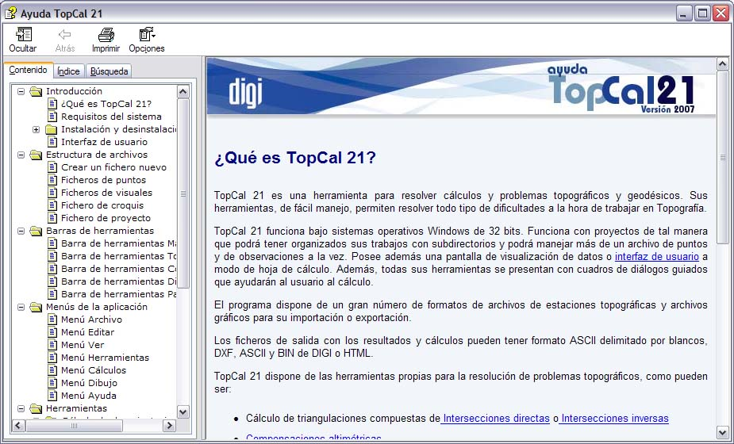
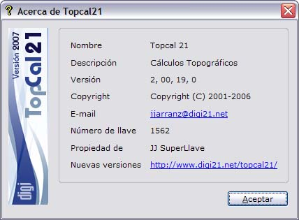

# Menú Ayuda
<!-- id: menu-ayuda -->

En este menú están los comandos relacionados con la ayuda para la utilización de la aplicación y sus herramientas, como son:

*  **Temas de ayuda**: Muestra la ayuda del programa.

  
*  **Acerca de TopCal 21**: Muestra información acerca de la versión de TopCal 21.

  
