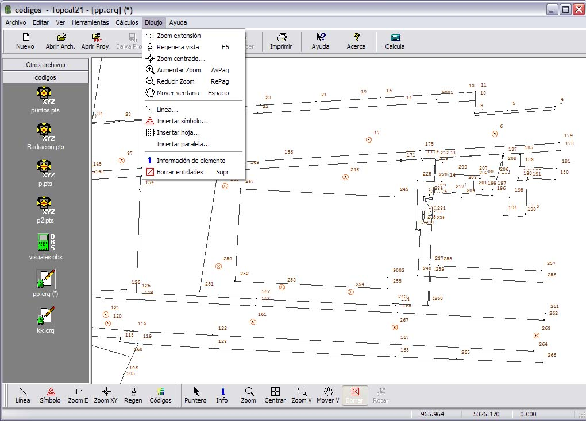
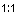
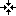
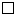
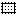
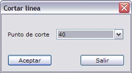

# Menú Dibujo
<!-- id: menu-dibujo -->

Este menú contiene los diversos comandos útiles para la edición de los datos de croquis, como pueden ser:

*  **Zoom extensión**: Ajusta la vista para visualizar toda la extensión del documento de dibujo actual. Esta opción sólo estará habilitada si se tiene activo un archivo de croquis.
*  **Regenera vista**: Vuelve a dibujar el croquis en la vista actual. Esta opción sólo estará habilitada si se tiene activo un archivo de croquis. Esta herramienta puede ser seleccionada pulsando la tecla \[F5\].
*  [Zoom centrado](../dibujo/centrar-pantalla-sobre-punto.md): Centra la ventana actual sobre un determinado punto o unas determinadas coordenadas. Esta opción sólo estará habilitada si se tiene activo un archivo de croquis.
* **Aumentar Zoom**: Aumenta la vista actual del documento. Esta herramienta puede ser seleccionada pulsando la tecla \[AvPag\].
* **Reducir Zoom**: Reduce la vista actual del documento. Esta herramienta puede ser seleccionada pulsando la tecla \[RePag\].
* **Mover ventana**: Con esta opción se puede mover la visualización en tiempo real, pulsando el botón izquierdo sin soltar y moviendo el ratón. Esta herramienta puede ser seleccionada manteniendo pulsada la tecla \[ESPACIO\].
*  **Línea**: Al seleccionar esta herramienta se podrán registrar entidades geográficas (líneas o arcos) seleccionando gráficamente en pantalla los puntos que las definen. Esta opción sólo estará habilitada si se tiene activo un archivo de croquis. La forma de actuar en la siguiente:
  * Se podrá seleccionar un punto de recta pulsando el botón izquierdo del ratón.
  * Se podrá seleccionar un punto de arco pulsando el botón izquierdo del ratón más la tecla \[Mayúsculas\].
  * Se podrá borrar el último punto introducido pulsando la tecla \[ESC\].
  * Se podrá terminar la entidad pulsando el botón derecho del ratón, tras lo cual, el programa mostrará un [cuadro de diálogo](../dibujo/dibuja-entidad.md) con los puntos seleccionados para que se indique la capa en la que se registrará la entidad.
*  **Insertar cuadrado**: Al seleccionar esta herramienta se podrán registrar entidades lineales con forma de cuadrado seleccionando gráficamente en pantalla los puntos que definen una de las diagonales. Esta opción sólo estará habilitada si se tiene activo un archivo de croquis. La forma de actuar en la siguiente:
  * Se podrá seleccionar un punto de recta pulsando el botón izquierdo del ratón.
  * Se podrá borrar el último punto introducido pulsando la tecla \[ESC\].
  * Se podrá terminar la entidad pulsando el botón derecho del ratón, tras lo cual, el programa mostrará un [cuadro de diálogo](../dibujo/insertar-cuadrado.md) con los puntos seleccionados para que se indique la capa en la que se registrará la entidad.
*  **Insertar rectángulo**: Al seleccionar esta herramienta se podrán registrar entidades lineales con forma de rectángulo seleccionando gráficamente en pantalla los puntos que definen tres de sus esquinas. Esta opción sólo estará habilitada si se tiene activo un archivo de croquis. La forma de actuar en la siguiente:
  * Se podrá seleccionar un punto de recta pulsando el botón izquierdo del ratón.
  * Se podrá borrar el último punto introducido pulsando la tecla \[ESC\].
  * Se podrá terminar la entidad pulsando el botón derecho del ratón, tras lo cual, el programa mostrará un [cuadro de diálogo](../dibujo/insertar-rectangulo.md) con los puntos seleccionados para que se indique la capa en la que se registrará la entidad.
*  [Insertar círculo](../dibujo/insertar-circulo.md): Herramienta para registrar una entidad en forma de círculo cerrado a partir de datos diversos: centro, radio, puntos en el límite, etc.
*  [Insertar símbolo](../dibujo/insertar-simbolo.md): Muestra un cuadro de diálogo que permite registrar símbolos puntuales en puntos pertenecientes a los ficheros que están relacionados con el croquis. Esta opción sólo estará habilitada si se tiene activo un archivo de croquis.
*  [Insertar hoja](../dibujo/insertar-hoja.md): Muestra un cuadro de diálogo con el que se podrá insertar una hoja de referencia sobre el dibujo, en la que podrán aparecer coordenadas en los márgenes y cruces en su interior.
* [Insertar paralela](../dibujo/insertar-paralela.md): Herramienta para generar una paralela a una entidad registrada.
* **Insertar por teclado**: En este submenú se agrupan aquellas herramientas de dibujo a las que también se puede acceder por medio de un cuadro de diálogo donde se podrán introducir los puntos que definen las formas geométricamente:
  *  [Línea](../dibujo/dibuja-entidad.md): Muestra un cuadro de diálogo que permite registrar entidades geográficas (líneas o arcos) como unión de los puntos de los ficheros que están relacionados con el croquis. Esta opción sólo estará habilitada si se tiene activo un archivo de croquis.
  *  [Insertar cuadrado](../dibujo/insertar-cuadrado.md): Herramienta para registrar una entidad lineal en forma de cuadrado a partir de dos puntos de una diagonal.
  *  [Insertar rectángulo](../dibujo/insertar-rectangulo.md): Herramienta para registrar una entidad en forma de cuadrilátero a partir de tres de sus esquinas.
* **Cortar línea**: Herramienta para cortar una línea por alguno de sus puntos vértices generando, de esta forma, dos entidades diferentes. Una vez elegida la línea para cortar el programa mostrará un cuadro de diálogo en el que se deberá designar el punto de corte. Para designar la línea que desea dividir se deberá seleccionar con el botón izquierdo del ratón y aceptar la selección con este mismo botón. Si no se seleccionó la entidad deseada se podrá pulsar el botón derecho del ratón para que el programa continúe buscando entidades en la misma localización.

  
* **Juntar líneas**: Herramienta para juntar dos entidades lineales en una sola. Para ello ambas entidades deberán pertenecer a la misma capa. No es necesario que coincidan los puntos en los extremos. Si no coinciden el programa los unirá con un nuevo segmento. Para seleccionar las entidades a juntar se deberán señalar con el botón izquierdo del ratón, aceptando con este mismo botón cuando se hayan seleccionado las dos entidades deseadas. Si no se seleccionaron las entidades deseadas se podrá pulsar el botón derecho del ratón para que el programa continúe buscando entidades en la misma localización.
* **Releer códigos de croquización**: Herramienta para volver a leer la información contenida en el campo *Código* de los ficheros de puntos vinculados al croquis actual. Su utilidad reside en la necesidad de volver a crear las líneas automáticas cuando se hace algún cambio manual en el campo *Código* del fichero de puntos después de haber creado el croquis. El croquis se actualiza automáticamente cuando existe un cambio en las coordenadas de los puntos, pero no cuando el cambio de produce en el campo *Código*, por lo que habría que ejecutar esta herramienta
* ** Información de elemento**: Herramienta para ofrecer información acerca del elemento seleccionado. Pulse el botón izquierdo para seleccionar el elemento deseado y vuelva a pulsarlo para confirmar la selección. Pulse el botón derecho para deseleccionarlo o para buscar otro elemento en la misma localización. También se puede deseleccionar pulsando la tecla \[ESC\].
* **Borrar entidades**: Con esta opción se pueden borrar elementos de un dibujo. Esta herramienta puede ser seleccionada pulsando la tecla \[SUPR\].
