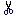
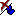
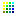
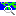
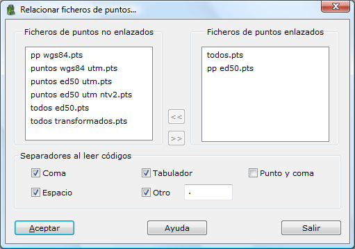

# Menú Editar
<!-- id: menu-editar -->

En este menú están reunidos los comandos referentes a la edición de los datos de la hoja de cálculo así como las opciones de visualización de dichos datos. También contiene las herramientas para la gestión de sistemas de referencia e instrumentos topográficos. Estos comandos son los siguientes:

* ** Deshacer**: Deshace la última operación. Sólo estará activo si se realizó algún cambio en el documento. A esta herramienta también se puede acceder con la combinación de teclas *Ctrl + Z*.
*  **Rehacer**: Rehace la última operación deshecha con el comando Deshacer. Sólo estará activo si se deshizo alguna operación anterior. A esta herramienta también se puede acceder con la combinación de teclas *Ctrl + Y*.
*  **Cortar**: Corta los datos seleccionados actualmente al portapapeles de Windows, borrándolos del archivo. Sólo estará activo si se tiene seleccionado algún dato en la hoja de cálculo. A esta herramienta también se puede acceder con la combinación de teclas *Ctrl + X*.
*  **Copiar**: Copia los datos seleccionados actualmente al portapapeles de Windows. Sólo estará activo si se tiene seleccionado algún dato en la hoja de cálculo. A esta herramienta también se puede acceder con la combinación de teclas *Ctrl + C*.
*  **Pegar**: Pega los datos del portapapeles de Windows al archivo actual. Sólo estará activo si se tiene algún dato almacenado en el portapapeles de Windows. A esta herramienta también se puede acceder con la combinación de teclas *Ctrl + V*.
* **Seleccionar todo**: Selecciona todos los datos de la hoja de cálculo actual. A esta herramienta también se puede acceder con la combinación de teclas *Ctrl + E*.
* **Invierte selección**: Este comando sirve para seleccionar los registros que actualmente no estén seleccionados. Es útil cuando es más fácil seleccionar lo que no se quiere, por ejemplo, cuando hay que borrar todos los registros menos dos de ellos, se seleccionan éstos y se llama a este comando, seleccionándose sólo el resto, pudiendo proceder a su borrado.
*  **Borrar registro**: Pone una marca de borrado al registro actual o a los registros seleccionados. Si se tiene activo que se presenten dichos registros, estos se mostrarán en color rojo en la hoja de cálculo. Para activar esta opción consulte el cuadro de diálogo [Preferencias](../opciones-de-visualizacion/preferencias.md)
*  **Recuperar registro**: Quita la marca de borrado de los registros seleccionados.
* **Comprimir archivo**: Elimina definitivamente del archivo los registros con marca de registro borrado.
* [Renumerar puntos](../otros-comandos/renumerar-puntos.md): Renumera los puntos del fichero actual. Sólo estará activo si se tiene activo un archivo de puntos.
* [Renumerar visuales](../otros-comandos/renumerar-visuales.md): Renumera las visuales del fichero actual. Sólo estará activa si se tiene activo un archivo de visuales.
* [Preferencias](../opciones-de-visualizacion/preferencias.md): Muestra las opciones generales de la aplicación.
* [Preferencias de croquis](../opciones-de-visualizacion/preferencias-de-croquis.md): Muestra las opciones generales de dibujo de la aplicación.
*  [Lista de códigos de dibujo](../opciones-de-visualizacion/preferencias-de-dibujo/listado-de-codigos-de-dibujo.md): Muestra la lista de códigos de dibujo.
*  [Lista de códigos de croquización](../opciones-de-visualizacion/preferencias-de-croquizacion/lista-de-codigos-de-croquizacion.md): Muestra la lista de códigos de croquización automática.
*  [Librería de símbolos](../opciones-de-visualizacion/preferencias-de-simbolizacion/libreria-de-simbolos.md): Muestra la lista de símbolos disponibles para insertar en el croquis.
*  [Sistemas de referencia](../otros-comandos/sistemas-de-referencia/listado-de-sistemas-de-referencia.md): Muestra un listado con los sistemas de referencias almacenados en la aplicación, útiles para la creación de ficheros de puntos.
*  [Instrumentos topográficos](../otros-comandos/instrumentos-topograficos/listado-de-instrumentos-topograficos.md): Muestra un lista con los instrumentos topográficos almacenados en la aplicación, útiles para la creación de ficheros de visuales.
* **Relacionar ficheros de puntos**: Relaciona un [fichero de croquis](../estructura-de-archivos/fichero-de-croquis.md) con los ficheros de puntos del proyecto actual.

  
