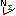
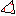
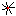
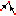
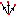
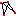
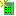
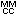

# Menú Herramientas
<!-- id: menu-herramientas -->

En este menú están las principales herramientas de cálculo topográfico que contiene el programa. Prácticamente todas las herramientas requieren la existencia de un proyecto para su ejecución. Estas herramientas son:

*  [Desorientaciones](../herramientas/calculo-de-desorientaciones/README.md): Permite calcular la desorientación de un punto en base a observaciones a otros puntos de coordenadas conocidas. Esta opción sólo estará habilitada si se tiene activo un proyecto.
*  [Cierre de triángulos](../herramientas/cierre-de-triangulos/README.md): Permite calcular los cierres de triángulos formados por un conjunto de observaciones realizadas entre puntos. Esta opción sólo estará habilitada si se tiene activo un archivo de observaciones. No es necesario tener archivos de puntos.
*  [Radiación](../herramientas/radiacion/README.md): Permite calcular las coordenadas de nuevos puntos a partir de las coordenadas de una estación y las observaciones de ángulo y distancia correspondientes. Esta opción sólo estará habilitada si se tiene activo un proyecto.
*  [Poligonales](../herramientas/poligonales/README.md): Permite calcular las coordenadas de nuevos puntos a partir de las concatenación de observaciones de ángulos y distancias realizadas entre estos puntos y al menos uno de coordenadas conocidas. Esta opción sólo estará habilitada si se tiene activo un proyecto.
* [Poligonales alternas](../herramientas/poligonales/README.md): Esta variante del cálculo de poligonales permite calcular las coordenadas de un conjunto de estaciones en poligonales alternas, en las que el instrumento no se estaciona en todos los puntos sino de forma alternativa. En cada tramo hay una sola distancia y un solo desnivel, por lo que el programa no puede comprobarlos con valores recíprocos.
*  [Intersecciones directas](../herramientas/intersecciones-directas/README.md): Permite calcular las coordenadas de nuevos puntos a partir de las observaciones de ángulo realizadas desde al menos dos puntos de coordenadas conocidas. Esta opción sólo estará habilitada si se tiene activo un proyecto.
*  [Intersecciones inversas](../herramientas/intersecciones-inversas/README.md): Permite calcular las coordenadas de nuevos puntos a partir de las observaciones de ángulos realizadas a al menos tres puntos de coordenadas conocidas. Esta opción sólo estará habilitada si se tiene activo un proyecto.
*  [Intersecciones de Hansen](../herramientas/intersecciones-de-hansen/README.md): Permite calcular las coordenadas de dos puntos a partir de las observaciones de ángulo realizadas a otros dos puntos de coordenadas conocidas. Esta opción sólo estará habilitada si se tiene activo un proyecto.
*  [Bisección Mixta](../herramientas/biseccion-mixta/README.md): Permite calcular las coordenadas de un punto a partir de las observaciones angulares y de distancia a otros dos puntos de coordenadas conocidas realizadas desde dicho punto. Esta opción sólo estará habilitada si se tiene activo un proyecto.
*  [Cálculo de altimetría](../herramientas/compensacion-de-altimetria/README.md): Permite calcular la coordenada Z de un conjunto de puntos a partir de las observaciones realizadas en una red altimétrica, partiendo de al menos un punto con cota conocida. Esta opción sólo estará habilitada si se tiene activo un proyecto.
*  [Replanteo](../herramientas/replanteo/README.md): Permite generar un archivo con las observaciones de ángulo y distancia que deben realizarse para situar puntos nuevos en el terreno, en la operación de replanteo. Esta opción sólo estará habilitada si se tiene activo un proyecto.
*  [Generar libreta](../herramientas/generar-libreta-de-campo/README.md): Permite generar un archivo de observaciones a partir de las coordenadas conocidas de un conjunto de puntos. Esta opción sólo estará habilitada si se tiene activo un proyecto.
* Croquis de visuales: Permite generar un archivo de croquis con las observaciones realizadas desde una estación. Esta opción sólo estará habilitada si se tiene activo un proyecto.
*  [Mínimos Cuadrados](../herramientas/compensacion-por-minimos-cuadrados/README.md): Permite ajustar por el método matemático de mínimos cuadrados una red formada por un conjunto de puntos entre los que se han realizado observaciones angulares y/o de distancia y/o de altimetría. Esta opción sólo estará habilitada si se tiene activo un proyecto. Para realizar este cálculo es necesario tener calculadas unas coordenadas aproximadas de los puntos no fijos que componen la red.
*  [Transformación de coordenadas](../herramientas/transformacion/README.md): Transforma las coordenadas de un archivo de puntos al sistema de coordenadas definido por los puntos de otro archivo, utilizando los puntos comunes a ambos sistemas. Esta opción sólo estará habilitada si se tiene activo un proyecto.
