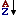

# Menú Ver
<!-- id: menu-ver -->

En este menú están los comandos para la visualización de las barras de herramientas, iconos de los archivos y propiedades de los diferentes objetos. Esto comandos son:

* [Barra de herramientas](../opciones-de-visualizacion/ver-barras-de-herramientas.md): Muestra un cuadro de diálogo que permite seleccionar las barras de herramientas que se desean visualizar y su aspecto.
* **Barra de estado**: Permite activar o desactivar la barra de estado en la parte inferior de la ventana de la aplicación, donde se visualizan los mensajes del programa al usuario y las coordenadas en los archivos de croquis
*  [Ordenar datos](../opciones-de-visualizacion/ordenar-datos.md): Muestra un cuadro de diálogo que permite ordenar el fichero actual por alguno de sus campos.
* **Actualiza**: Regenera la vista actual, volviendo a presentar los datos. A esta herramienta también se puede acceder con la de tecla *F5*.
* **Iconos pequeños**: Muestra los elementos del proyecto con iconos pequeños.
* **Iconos grandes**: Muestra los elementos del proyecto con iconos grandes.
* **Organizar iconos**: Permite organizar los elementos del proyecto actual por *nombre*, *tipo*, *tamaño* o *fecha*. Además permite que organizar los elementos de forma automática.
*  [Propiedades del proyecto](../opciones-de-visualizacion/propiedades-de-los-objetos/propiedades-del-proyecto.md): Muestra un cuadro de diálogo con las propiedades del proyecto actual.
*  **Propiedades del objeto**: Muestra un cuadro de diálogo con las propiedades del elemento actual, ya sea un archivo de [puntos](../opciones-de-visualizacion/propiedades-de-los-objetos/propiedades-del-archivo-de-puntos.md), de [observaciones](../opciones-de-visualizacion/propiedades-de-los-objetos/propiedades-del-archivo-de-visuales.md) o de [croquis](../opciones-de-visualizacion/propiedades-de-los-objetos/propiedades-del-archivo-de-croquis.md).
*  **Calculadora**: Muestra la calculadora del sistema, para realizar operaciones de cálculo sencillas.
