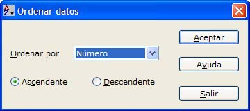

# Ordenar datos
<!-- id: ordenar-datos -->

En este cuadro de diálogo se podrá ordenar el fichero de puntos o de observaciones en función de alguno de sus campos, en orden ascendente o descendente.

