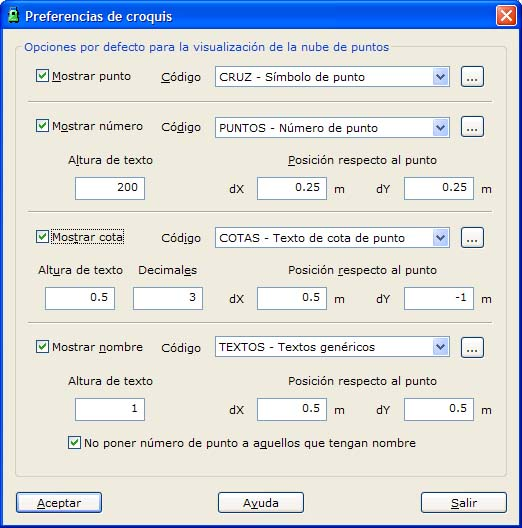

# Preferencias de croquis
<!-- id: preferencias-de-croquis -->

Desde este cuadro de diálogo se pueden configurar las opciones básicas de visualización de la nube de puntos de un croquis. Los datos que se pueden presentar por cada punto son los siguientes:

* **Punto**: El punto es una entidad geográfica puntual situada en las coordenadas XYZ que contiene el punto en el fichero.
* **Número**: El número de punto es la cifra que identifica a éste. Se puede indicar su tamaño en milímetros de ploteo y el desplazamiento del texto respecto del punto.
* **Cota**: La cota se puede mostrar como un texto junto al punto. Se podrá indicar su tamaño en milímetros de ploteo y el número de decimales que se desean visualizar. Además, se puede indicar el desplazamiento del texto respecto del punto en metros.
* **Nombre**: El nombre del punto es el texto que se almacena en el campo del mismo nombre en el archivo de puntos. Es posible determinar su tamaño en milímetros de ploteo y el desplazamiento del texto respecto del punto. Si el punto tiene nombre y éste se visualiza, es posible activar la opción de no visualizar el número de punto, de modo que el croquis muestre el nombre del punto sin su número.

Para todos los elementos mostrados se puede elegir un código de dibujo de la lista. Si el código elegido no está en la lista, se puede acceder al [gestor de los códigos de dibujo](preferencias-de-dibujo/listado-de-codigos-de-dibujo.md) para añadir uno nuevo o modificar algún existente.

Para señalar el desplazamiento de los textos respecto del punto, ha de tenerse en cuenta que las coordenadas de los textos son referidas respecto de la esquina inferior izquierda de éstos.

Pulse el botón **Aceptar** para aplicar los cambios y cerrar el cuadro. Pulse el botón **Salir** para cerrar el cuadro sin guardar los cambios.
