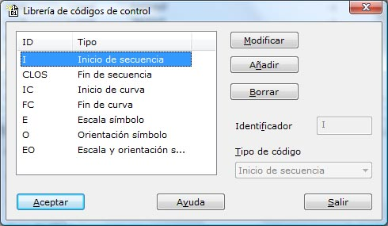

# Librería de códigos de control
<!-- id: libreria-de-codigos-de-control -->

Los códigos de control son aquellos utilizados por el programa para conocer dónde se encuentra los comienzos o final de registro de entidades. Estos códigos se añaden a los códigos de la entidad, antes o después, y separados por un espacio.

El programa muestra un cuadro de diálogo, donde se muestra una relación de los códigos de control existentes para realizar un croquis de manera automática.

Los códigos de control disponibles son los siguientes:

* **Inicio de secuencia**: Por defecto, se toma como *I*. Cuando el programa encuentre este código interpretará que comienza el registro de dicha entidad. En caso de que se estuviera registrando otra entidad con el mismo código la finalizará, aunque no haya encontrado código de finalización de secuencia.
* **Fin de secuencia**: Por defecto, se toma como *CLOS*. Cuando el programa encuentre este código interpretará que termina el registro de dicha entidad.
* **Inicio de curva**: Por defecto se toma como *IC*. Cuando el programa encuentre este código interpretará que empieza un elemento curvo, por lo que calculará la curva que pasa por el punto y por los puntos siguientes hasta que se encuentra un código de fin de curva.
* **Fin de curva**: Por defecto se toma como *FC*. Cuando el programa encuentre este código interpretará que termina el registro de un elemento curvo.
* **Escala símbolo**: Por defecto se toma como *E*. Cuando el programa encuentre este código interpretará que el punto determina el tamaño del símbolo colocado previamente en otro punto. La escala será la distancia entre ambos.
* **Orientación símbolo**: Por defecto se toma como *O*. Cuando el programa encuentre este código interpretará que el punto determina la orientación del símbolo colocado previamente en otro punto.
* **Escala y orientación símbolo**: Por defecto se toma como *EO*. Cuando el programa encuentre este código interpretará que el punto determina el tamaño y la orientación del símbolo colocado previamente en otro punto.
* **Escala XY y orientación símbolo**: Por defecto se toma como *EXYO*. Cuando el programa encuentre este código interpretará que el punto determina la escala en Y. Debería ir precedido de un código de *escala y orientación* donde se indicó la escala en X y la orientación del símbolo.
* **Fin de secuencia de superficies**: Por defecto se toma como *SUP*. Cuando el programa encuentre este código interpretará que el punto es el último de una línea que además es cerrada por lo que incluirá automáticamente como último tramo un vector hasta el primer punto de la entidad.
* **Continuar secuencia anterior**: Por defecto se toma como *CONT*. Cuando el programa encuentre este código interpretará que el usuario quiere continuar la última entidad que se registró con el mismo código aunque esta haya sido finalizada.

Una vez que se ha concluido la definición se deberá pulsar el botón **Aceptar** para visualizar los datos o el botón **Salir** para salir del cuadro de diálogo.
