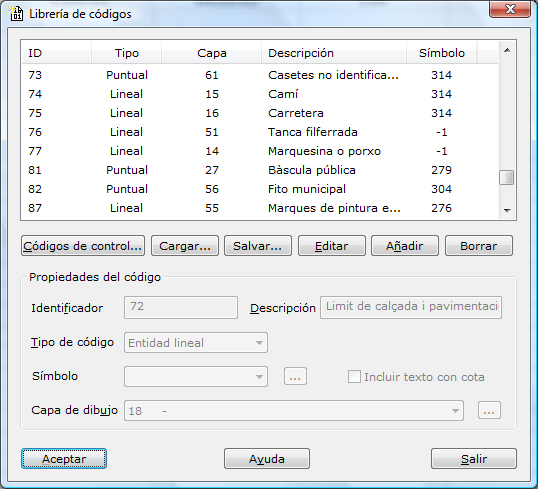

# Librería de códigos
<!-- id: libreria-de-codigos -->

En este cuadro de diálogo se muestra una relación de los códigos existentes y las capas de dibujo en la que se registrarán cuando se realice el croquis.

Los códigos son anotaciones realizadas en campo junto con las observaciones realizadas, para facilitar la labor de gabinete de elaboración de la cartografía.

Es decir, cuando se están registrando puntos es posible añadir información adicional indicando a qué tipo de entidad geográfica corresponde el punto (acera, edificio, registro, etc.) para que, posteriormente, al calcular el programa las coordenadas de los puntos tenga la posibilidad de reconstruir automáticamente las entidades registradas en campo.

Esto evitaría la necesidad de llevar un croquis en campo donde se anotan los puntos que se van tomando.

Para que el programa reconstruya las entidades de manera correcta es necesario incluir ciertas anotaciones que indican dónde empiezan o terminan las entidades, o dónde empieza o termina un arco de círculo, etc. Estas anotaciones se denominan códigos de control. Para editar esos códigos, pulse el botón [Códigos de control](lista-de-codigos-de-control.md) situado en la parte inferior izquierda del listado de códigos.

En el cuadro de diálogo que se muestran aparecen tres botones en la parte inferior derecha del listado de códigos (**Editar**, **Añadir** y **Borrar**) que permiten modificar, añadir y eliminar códigos de croquización, respectivamente.

Al pulsar el botón **Añadir** o **Editar** los campos situados en la parte inferior son activados para permitir su modificación. Estos campos son los siguientes:

* **Identificador**: Este identificador se corresponde con la anotación asociada al punto registrado y que deberá relacionarse con la entidad geográfica que se está registrando. Suelen ser cadenas de caracteres cortas, para tardar menos en introducirlas, por ejemplo, *A* se corresponde con *Aceras*, *E* con *Edificaciones*, *B* con *Bordillo*, etc. Si se estuvieran registrando dos edificaciones al mismo tiempo se podría utilizar los identificadores *E1* y *E2*, para que el programa no relacione puntos de manera equívoca. Si el punto es comienzo o final de entidad o comienzo o final de curva, asociado a este identificador deberá llevar el código de control correspondiente, separada por un espacio. Por ejemplo, comienzo de acera “*A I*”, comienzo de arco de bordillo “*B IC*”, etc.
* **Descripción**: Este campo esta reservado para que el usuario introduzca información para detallar en mayor medida el identificador. Es opcional.
* **Tipo de código**: Se podrá elegir entre entidad lineal o entidad puntual. Si la entidad es de tipo puntual, se activará el siguiente campo para reseñar un posible símbolo.
* **Símbolo**: Si la entidad es de tipo puntual, el usuario podrá indicar un símbolo asociada con el código para que sea ubicado en la posición del punto. El listado de símbolos disponibles se muestran en la herramienta [Librería de símbolos](../preferencias-de-simbolizacion/libreria-de-simbolos.md) del [Menú Editar](../../menus-de-la-aplicacion/menu-editar.md).
* **Incluir texto con cota**: Si la entidad es de tipo puntual, el usuario podrá indicar que el punto siempre muestre un texto con el valor de la cota. Este campo estará destinado para aquellos códigos registrados en campo que se considerarán puntos acotados en la cartografía final. Las características del texto colocado serán las mismas que las reseñadas en el cuadro de diálogo [Preferencias de croquis](../preferencias-de-croquis.md).
* **Capa de dibujo**: Este campo está reservado para indicar la capa de dibujo en la que se registrará la entidad. Es decir, existe la posibilidad de que varios códigos de croquización generen entidades para la misma capa. Siguiendo con el ejemplo anterior, *E*, *E1* y *E2* generarán entidades de dibujo que se registrarán en la capa *EDIFICACION*. Estas capas son definidas en la herramienta [Lista de códigos de dibujo](../preferencias-de-dibujo/listado-de-codigos-de-dibujo.md) del [Menú Editar](../../menus-de-la-aplicacion/menu-editar.md). Si la capa no ha sido creada y, por tanto, no se encuentra en el listado mostrado, se puede acceder a esta herramienta pulsando el botón situado a la derecha.

Al añadir un código de croquización se podrá observar que al tiempo que son activados los campos, se desactivan todos los botones excepto el botón **Añadir** y **Cancelar**, para permitir al usuario aceptar o descartar los datos introducidos. Igualmente ocurre cuando se están modificando datos, donde sólo se quedan activos los botones **Editar** y **Cancelar**.

Existen dos botones adicionales situados en la parte inferior central del listado de códigos que permiten **Cargar** o **Salvar** los listados a disco.

Una vez que se ha concluido la definición se deberá pulsar el botón **Aceptar** para visualizar los datos o el botón **Salir** para salir del cuadro de diálogo.
