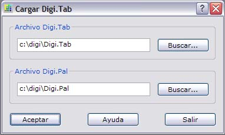

# Cargar DIGI.TAB
<!-- id: cargar-digi-tab -->

En este cuadro de diálogo se podrán cargar los códigos de visualización de DIGI. Indique la ubicación del archivo **DIGI.TAB** y del archivo **DIGI.PAL**, donde están definidos los colores, para cargar los códigos y sus colores.

Si no se encuentra el archivo DIGI.PAL el programa asignará los colores de MS-DOS.
