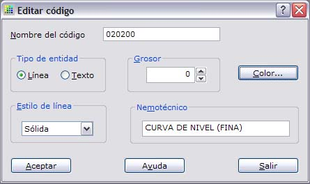

# Código de dibujo nuevo
<!-- id: codigo-de-dibujo-nuevo -->

En este cuadro de diálogo aparecen los siguientes campos a rellenar:

* **Nombre del código**: Se especificará el nombre del código nuevo, o en caso de no ser nuevo, se editará el existente.
* **Tipo de entidad**: Podrá ser línea (**C**) o texto (**T**).
* **Grosor**: Se especificará un grosor de línea entre 0 y 10.
* **Estilo de línea**: Podrá ser Sólida (línea continua), Líneas (línea a trazos), Puntos (línea a puntos), Línea-Punto, Línea-Punto-Punto.
* **Color**: Se podrá especificar un color.
* **Nemotécnico**: Se podrá asignar un texto explicativo del código nuevo.
