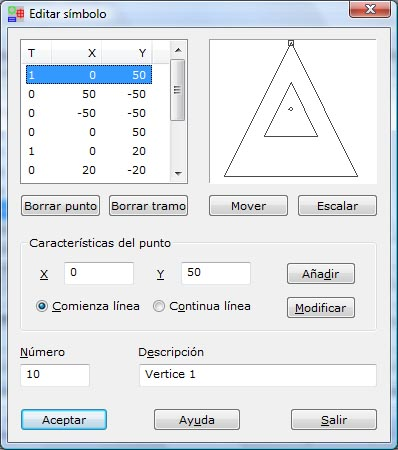

# Editar símbolo
<!-- id: editar-simbolo -->

En este cuadro de diálogo se muestran las características de un símbolo, incluyendo las entidades, compuestas por puntos, que lo definen.

Se muestra un listado con las coordenadas de los puntos que definen el símbolo, con un campo adicional a la izquierda que indica si el punto es comienzo de un nuevo tramo (1) o continuación del existente (0). Al seleccionar un punto de esta lista, la vista preliminar de la derecha muestra un cuadrado que indica la posición de ese punto. En el mismo dibujo, se muestra un punto indicando el punto de anclaje del símbolo que corresponde con las coordenadas 0,0.

Existe la posibilidad de borrar un único punto del tramo o borrar todo un tramo, utilizando para ello, los botones situados en la parte inferior.

Además, se puede **Añadir** un punto nuevo o **Modificar** uno existente empleando los campos situados a continuación. En estos campos se podrán designar las **coordenadas** X e Y del punto en décimas de milímetro, así como si **comienza** un nuevo tramo o **continua** el actual.

El tamaño de diseño del símbolo es el mismo que tendrá éste una vez que se imprima, por lo que su tamaño en pantalla dependerá del valor de la escala del croquis.

Se pueden mover o escalar las coordenadas del símbolo pulsando los botones **Mover** o **Escalar**.

Por último, es posible modificar el **Número** que identifica al símbolo y su **Descripción**.

Una vez que se ha concluido la definición se deberá pulsar el botón **Aceptar** para visualizar los datos o el botón **Salir** para salir del cuadro de diálogo.
