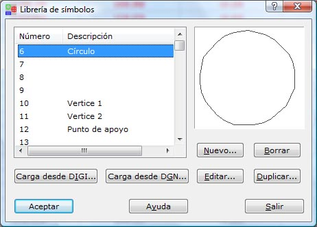

# Librería de símbolos
<!-- id: libreria-de-simbolos -->

En este cuadro de diálogo se muestra una relación de los símbolos disponibles para ser insertados en el croquis y una vista previa de sus dibujos.

Los identificadores de los símbolos son almacenados como cadenas numéricas, pudiendo añadir una descripción. Existe la posibilidad de cargar los símbolos utilizados desde DIGI, empleando para ello el archivo TEXT.FNT. A esta posibilidad se accede con el botón **Carga desde DIGI…**.

Igualmente, existe la posibilidad de cargar las células almacenadas en un archivo con extensión CEL propio de MicroStation. A esta posibilidad se accede con el botón **Carga desde DGN…**.

Desde este cuadro de diálogo se podrá crear un símbolos **Nuevo**, **Borrar** un símbolo, **Editar** un símbolo o **Duplicar** un símbolo con otro nombre, pulsando los botones disponibles al efecto. Al editar o crear un símbolo, el programa muestra el cuadro de diálogo [Editar símbolo](editar-simbolo.md).

Una vez que se ha concluido la definición se deberá pulsar el botón **Aceptar** para visualizar los datos o el botón **Salir** para salir del cuadro de diálogo.
