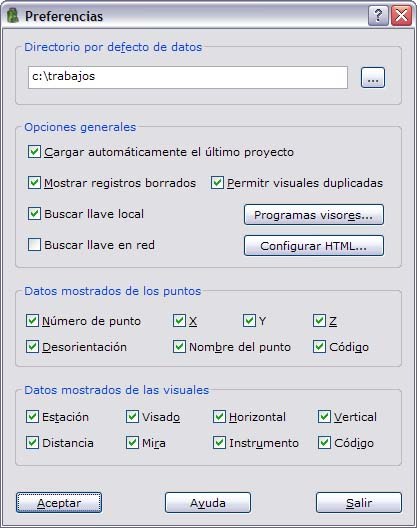

# Preferencias
<!-- id: preferencias -->

Desde este cuadro de diálogo se pueden configurar las opciones básicas de visualización de los datos (puntos y visuales), así como configurar el directorio por defecto donde se van a almacenar los proyectos generados, y otras opciones de la aplicación:

* **Directorio por defecto de datos**: Este directorio indica dónde se generarán las carpetas que contienen los proyectos generados. Puede utilizar el botón de la derecha para mostrar un árbol con las unidades disponibles y seleccionar un directorio nuevo. Si se teclea el directorio y éste no existe, la aplicación lo generará nuevo.
* **Opciones generales**:
  * **Cargar automáticamente el último proyecto**: Esta opción permite mostrar automáticamente al iniciar el programa el último proyecto que se modificó la última vez que se accedió al programa.
  * **Mostrar registros borrados**: Permite mostrar en el listado actual aquellos registros que hubieran sido marcados con la marca de Borrado. Estos registros se mostrarán en un color rojo.
  * **Permitir visuales duplicadas**: Permite tener almacenadas en el fichero de visuales, varias observaciones entre los mismos dos puntos. Esta opción es útil si se desean calcular los errores sistemáticos del aparato topográfico, para lo cual es necesario tener las observaciones realizadas en círculo directo y círculo inverso.
  * **Configuración de la llave**: Desde aquí se podrá configurar dónde debe buscar el programa la llave de protección. Esta llave podrá estar conectada a un puerto USB del ordenador o en un servidor. Para ello se deberá indicar **Buscar llave local** en el primer caso y/o **Buscar llave en red** en el segundo caso. Si no se tiene llave en red, se deberá desactivar esta segunda opción ya que si no, el programa perderá tiempo intentando buscar la llave en la red de ordenadores.
  * **Programas visores**: Desde este botón se puede configurar la ubicación de los programas que se utilizarán para visualizar los informes de salida con los cálculos en su formato TXT y html.
  * **Configurar html**: Desde aquí podrá configurar la salida de los diferentes cálculos en formato html. Podrá seleccionar el tipo de Fuente de texto y el color de las tablas generadas por la aplicación.
* **Datos mostrados de los puntos**: Desde esta opción se pueden seleccionar los campos que se desean visualizar de los ficheros de puntos en la hoja de cálculo.
* **Datos mostrados de las visuales**: Desde esta opción se pueden seleccionar los campos que se desean visualizar de los ficheros de visuales en la hoja de cálculo.
* **Número de decimales de los datos por defecto**: Se disponen dos campos para indicar el número de decimales que se desean visualizar de los datos en los diferentes cálculos y listados que genera el programa. Los datos se diferencian por *angulares* y *lineales* (coordenadas y distancias). Estos valores se utilizarán para los proyectos que se generen nuevos. No obstante, posteriormente se podrán modificar individualmente para cada proyecto desde el cuadro de diálogo de [Propiedades del proyecto](propiedades-de-los-objetos/propiedades-del-proyecto.md).

Pulse el botón **Aceptar** para aplicar los cambios y cerrar el cuadro. Pulse el botón **Salir** para cerrar el cuadro sin guardar los cambios.

> [!NOTE]
> La opción **Configuración de la llave** solo se aplica a la protección con llave. Si el ordenador tiene una activación de licencias de software, Topcal21 usa la licencia y no consulta la llave. Consulta [Licencias de software](../../licencias-de-software/README.md).
