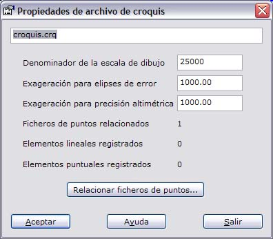

# Propiedades de archivo de croquis
<!-- id: propiedades-de-archivo-de-croquis -->

En este cuadro de diálogo se muestran las propiedades del archivo de croquis actual, entre las que se encuentran:

* **Nombre del archivo**
* **Denominador de la escala de dibujo**: Este valor condicionará el tamaño de los textos y símbolos que se le muestran en pantalla, como los números de los puntos o sus respectivas cotas.
* **Exageración para las elipses de error**: Factor de exageración para visualizar las elipses de error almacenadas en el croquis. Estas elipses de error se pueden generar después de realizar una [compensación por mínimos cuadrados](../../herramientas/compensacion-por-minimos-cuadrados/README.md) de una red topográfica.
* **Exageración para precisión altimétrica**: Factor de exageración para visualizar las líneas que representan la precisión altimétrica almacenadas en el croquis. Estas líneas se pueden generar después de realizar una [compensación por mínimos cuadrados](../../herramientas/compensacion-por-minimos-cuadrados/README.md) de una red topográfica.
* **Ficheros de puntos relacionados**: Número de ficheros de puntos que se están mostrando. Se podrá cambiar esta relación pulsando el botón **Relacionar ficheros de puntos**.
* **Elementos lineales registrados**
* **Elementos puntuales registrados**

Pulse el botón **Aceptar** para guardar los cambios del croquis. Pulse el botón **Salir** para cerrar el cuadro de diálogo.
