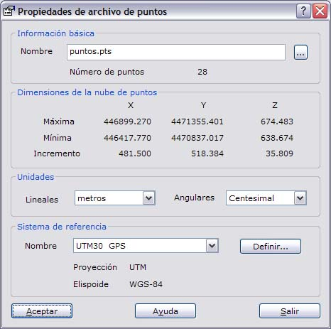

# Propiedades de archivo de puntos
<!-- id: propiedades-de-archivo-de-puntos -->

En este cuadro de diálogo se muestran las propiedades del archivo de puntos actual, entre las que se encuentran:

* **Nombre del archivo**
* **Cantidad de puntos** que contiene
* **Máximas y mínimas** de las coordenadas contenidas.
* **Unidades lineales**: Unidades en que están almacenadas las coordenadas de los puntos. Podrá optar entre *pies* y *metros*.
* **Unidades angulares**: Unidades en que están almacenadas las desorientaciones de los puntos. Podrá optar entre *centesimal*, *sexagesimal* y *sexagesimal pseudodecimal*.
* [Sistema de referencia](../../otros-comandos/sistemas-de-referencia/listado-de-sistemas-de-referencia.md): Se mostrará el sistema de referencia al que están referidas las coordenadas. Este sistema de referencia afectará directamente a la forma de calcular del programa. Podrá cambiar de sistema de coordenadas pulsando al botón **Definir**.

Pulse el botón **Aceptar** para guardar los cambios del archivo de puntos. Pulse el botón **Salir** para cerrar el cuadro de diálogo.
