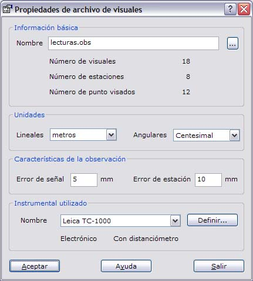

# Propiedades de archivo de visuales
<!-- id: propiedades-de-archivo-de-visuales -->

En este cuadro de diálogo se muestran las propiedades del archivo de visuales actual, entre las que se encuentran:

* **Nombre del archivo**
* **Cantidad de visuales** que contiene.
* **Cantidad de puntos estacionados**.
* **Cantidad de puntos visados**.
* **Unidades lineales**: Unidades en que están almacenadas las distancias, alturas de mira y alturas de instrumento de las visuales. Podrá optar entre *pies* y *metros*.
* **Unidades angulares**: Unidades en que están almacenados los ángulos medidos. Podrá optar entre *centesimal*, *sexagesimal* y *sexagesimal pseudodecimal*.
* **Características de la observación**: Error cometido en el estacionamiento y señalización de los puntos. En un estacionamiento con trípode y señalización con jalón es normal utilizar 5 mm. Si esta señalización fue tomada con mayor precisión podrá reducirse. Afectará únicamente al calcular la precisión de las visuales.
* [Instrumental utilizado](../../otros-comandos/instrumentos-topograficos/listado-de-instrumentos-topograficos.md): Se muestra el instrumental utilizado para la toma de las visuales almacenadas. Este instrumental podrá ser cambiado desde el botón **Definir**.

Pulse el botón **Aceptar** para guardar los cambios del archivo de visuales. Pulse el botón **Salir** para cerrar el cuadro de diálogo.
