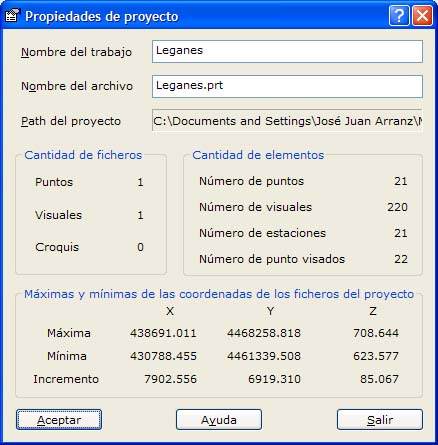

# Propiedades de proyecto
<!-- id: propiedades-de-proyecto -->

En este cuadro de diálogo se muestran las propiedades del proyecto actual, entre las que se encuentran:

* **Nombre del proyecto**
* **Nombre del trabajo**
* **Carpeta** donde se encuentra almacenado
* **Número de ficheros** de puntos, observaciones y croquis que contiene
* **Número de elementos**, como el número de puntos, visuales, estaciones y puntos visados.
* **Máximas y mínimas** de todas las coordenadas contenidas en los ficheros de puntos del proyecto.
* **Número de decimales de los datos**: Se disponen dos campos para indicar el número de decimales que se desean visualizar de los datos en los diferentes cálculos y listados generados con este proyecto Los datos se diferencian por *angulares* y *lineales* (coordenadas y distancias).

Pulse el botón **Aceptar** para guardar los cambios del proyecto. Pulse el botón **Salir** para cerrar el cuadro de diálogo.
