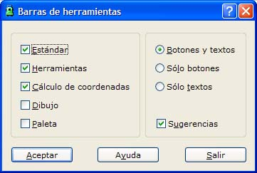

# Ver barras de herramientas
<!-- id: ver-barras-de-herramientas -->

En este cuadro de diálogo se pueden elegir las opciones de visualización disponibles en el programa que son:

* **Selección de las barras de herramientas deseadas**: Se seleccionarán las barras de herramientas que se utilicen más habitualmente para que sus iconos y llamadas estén más accesibles.
* **Selección de la información de las barras de herramientas**: Se podrá seleccionar que el programa sólo muestre el icono, el icono con un texto explicativo o sólo el texto.
* **Selección de opciones adicionales**: Se podrá seleccionar que el programa muestra información adicional al situarse con el ratón encima de la herramienta y que reproduzca un sonido cuando acaba las operaciones de cálculo.
