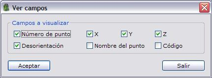
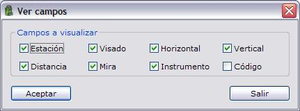

# Ver campos
<!-- id: ver-campos -->

Desde este cuadro de diálogo se pueden elegir los campos que se desean visualizar, tanto en los ficheros de puntos como en los ficheros de visuales. Para mostrar este cuadro de diálogo se debe pulsar con el botón de la derecha del ratón sobre la cabecera de los datos que se muestran en TopCal. De esta forma, se mostrará un menú contextual en el que se encuentra la opción **Ver campos**. Eligiéndola, se mostrará un cuadro de diálogo cuyo contenido variará en función del tipo de archivo actual:

* Si es un fichero de puntos, los datos que se pueden elegir son: *Número de punto*, *X*, *Y*, *Z*, *Desorientación*, *Nombre del punto* y *Código*.
* Si es un fichero de visuales, los datos que se pueden elegir son: *Estación*, *Visado*, *Horizontal*, *Vertical*, *Distancia*, *Mira*, *Instrumento* y *Código*.

También es posible seleccionar estos campos desde el cuadro de diálogo [Preferencias](preferencias.md) del [Menú Editar](../menus-de-la-aplicacion/menu-editar.md).
