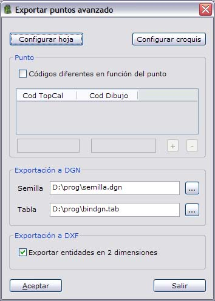

# Exportar puntos a archivo de dibujo
<!-- id: exportar-puntos-a-archivo-de-dibujo -->

Cuando se llama a la herramienta Exportar del [Menú Archivo](../menus-de-la-aplicacion/menu-archivo.md) teniendo activo un archivo de puntos se presenta un cuadro de diálogo donde se puede indicar el nombre del archivo y el tipo. Si el tipo elegido es de algún formato de archivo de dibujo (BIN o ASCII de DIGI, DXF de AutoCad o DGN de MicroStation) el programa permite configurar cómo se va a traducir la nube de puntos. A esta configuración se accede pulsando el botón **Avanzado…** que aparece.

Al pulsar **Avanzado…**, el programa muestra un cuadro de diálogo con los siguientes campos:

* **[Configurar hoja](../dibujo/insertar-hoja.md)**: Pulsando este botón se puede configurar el marco de hoja con coordenadas a insertar con la nube de puntos.
* **[Configurar croquis](../opciones-de-visualizacion/preferencias-de-croquis.md)**: Pulsando este botón se puede configurar la información que aparecerá por cada punto en el archivo de dibujo, es decir, si se quiere cota, número de punto, nombre de punto. Se podrán indicar igualmente los códigos, alturas de texto, etc.
* **Códigos diferentes en función del punto**: Por defecto todos los puntos se traducirán al mismo código o capa, sin embargo, es posible indicar al programa que almacene en diferentes capas del archivo de dibujo en función del código TopCal de cada punto. Para ello se deberá activar este campo y rellenar la tabla de relación que aparece debajo.
* **Exportación a DGN**: Cuando se traducen puntos al formato DGN de MicroStation es necesario indicar un archivo semilla. Este archivo es utilizado para conocer las características de traducción (unidades, dimensión, etc.). Adicionalmente, se puede indicar un archivo de traspaso de los códigos de visualización utilizados en el programa al formato de codificación de MicroStation (nivel, estilo, color, peso y grupo gráfico):
  * **Semilla**: Se indicará el nombre de un archivo DGN semilla. Es obligatorio. Debería ser un archivo vacío, porque el programa lo copia con el nombre del archivo DGN generado y conserva sus características (unidades, dimensión, etc.). Con la instalación del programa se proporciona un archivo semilla en tres dimensiones y con centímetros como unidad mínima.
  * **Tabla**: Se indicará el nombre de un archivo ASCII donde se indica como traducir las entidades. Es opcional. Con la instalación del programa también se proporciona una tabla de traducción de ejemplo. Cada línea del archivo deberá tener los campos separados por comas, espacios o tabuladores, estando en el siguiente orden:
    * Código DIGI: Código en el que están registradas las entidades en TopCal.
    * Nivel: Nivel del archivo DGN en el que se almacenarán las entidades con el código DIGI indicado.
    * Estilo: De la línea en el archivo DGN.
    * Color: De la línea en el archivo DGN.
    * Peso: Grosor de la línea en el archivo DGN.
    * Fuente de texto: Número de fuente en el archivo DGN.
    * Grupo gráfico: De la entidad en el archivo DGN.
    * Nombre de célula: Nombre del símbolo en el archivo DGN.
    * Tipo de elemento: Puede tomar los valores 0 (line string), 1 (shape), 2 (pattern line), 3 (célula) ó 4 (texto).
    * Alto del texto en metros: En el archivo DGN.
    * Ancho del texto en metros: En el archivo DGN.
    * Justificación del texto: En el archivo DGN.
    * Color de relleno: De la entidad cerrada en el archivo DGN.
* **Exportación a DXF**: Cuando se traducen puntos a formato DXF de AutoCad es posible indicar que la traducción sea en 2 dimensiones, es decir, utilizando entidades que no tienen cota. Para ello se deberá activar el campo que se indica.

Se puede pulsar el botón **Aceptar** para proceder con el cálculo o pulsar el botón **Salir** para volver al cuadro de diálogo anterior.
