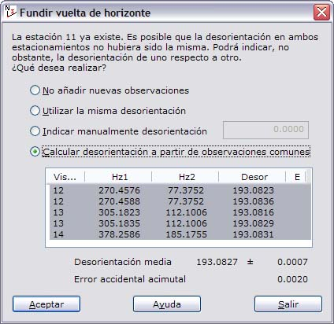

# Fundir vuelta de horizonte
<!-- id: fundir-vuelta-de-horizonte -->

Cuando se están importando o añadiendo archivos de observaciones a un archivo de observaciones con datos, puede ocurrir que se esté añadiendo una estación que ya se encuentra en el fichero. En este caso, el programa detecta el problema y procede a advertir de ello, porque podrían tener ambos estacionamientos diferente desorientación.

Esto ocurre cuando se han realizado dos estacionamientos en el mismo punto en días diferentes y se desea proceder a juntar todas las observaciones. Dos estacionamientos en el mismo punto pueden utilizar orígenes distintos para los ángulos horizontales. Por ello, no es aconsejable juntar todas las observaciones sin proceder a su tratamiento para que todos los ángulos horizontales estén referidos al mismo origen.

Por consiguiente, cuando se produzca este problema, TopCal 21 muestra el siguiente cuadro de diálogo, con diversas opciones:

El cuadro de diálogo muestra un mensaje con el número de la estación importada que ya existe en el fichero actual, y pregunta qué operación realizar entre las siguientes:

* **No añadir nuevas observaciones**: El programa no considerará las observaciones realizadas desde esta estación.
* **Utilizar la misma desorientación**: El programa añadirá las observaciones directamente al archivo actual sin aplicar ningún desfase a las lecturas horizontales. Esto ocurre cuando en ambos estacionamientos se fijó la desorientación del aparato al mismo lugar.
* **Indicar manualmente desorientación**: El programa suma el valor indicado en el campo que aparece a la derecha de esta opción a las lecturas horizontales de las observaciones importadas y añade esas observaciones al archivo actual.
* **Calcular desorientación a partir de observaciones comunes**: El programa busca observaciones comunes para ambos estacionamientos y las muestra en el listado. Para cada una de ellas calcula el desfase entre las observaciones realizadas el primer día con las del segundo día, mostrándolo en el listado. Según las observaciones realizadas, el programa calcula la **media** y la **desviación típica** y la muestra en la parte inferior del listado. Además, muestra el **error accidental** del instrumental para ayudar en la toma de decisiones sobre la idoneidad del cálculo. Para excluir una visual común del cálculo de la media de los desfases, deseleccione esa visual. No obstante, si alguno de los valores calculados difiere del valor medio más de 2.5 veces el valor de la desviación típica, el programa pone una marca "\*" a la derecha, indicando que esta visual es errónea a un 99% de probabilidad. El valor medio será sumado a las observaciones leídas antes de añadirlas al fichero.

Se puede elegir una de estas opciones y pulsar el botón **Aceptar** para hacerla efectiva o pulsar el botón **Salir** para abandonar la operación de Fundir vuelta.
