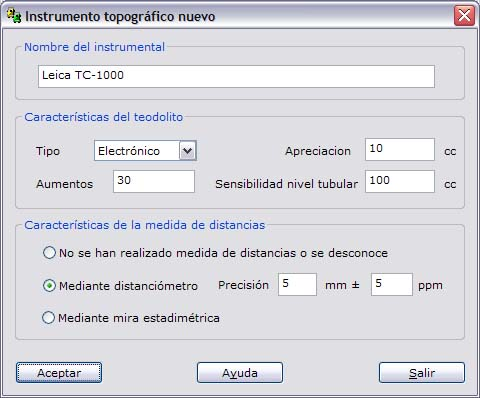

# Instrumento topográfico nuevo
<!-- id: instrumento-topografico-nuevo -->

El programa calcula la precisión de las observaciones utilizadas en un cálculo a partir del instrumental topográfico. Indique las características del instrumental que aparecen en el cuadro de diálogo, para que el programa utilice esa precisión al ponderar las observaciones:

* **Nombre del instrumental**: Se indicará un nombre único para el instrumental topográfico que ayude a su elección en los listados posteriores.
* **Características del teodolito**
  * *Tipo*: Se elegirá el tipo de teodolito, pudiendo elegir entre *Óptico* o *Electrónico*. Esta elección únicamente tendrá influencia en la fórmula utilizada para calcular el error de lectura en el aparato
  * *Apreciación*: Se indicará la mínima cantidad que permite el aparato leer en su sistema de medición de ángulos.
  * *Aumentos*: Se indicará la cantidad de aumentos que tienen las lentes.
  * *Sensibilidad del nivel tubular*: Se indicará la sensibilidad del nivel tubular del aparato.
* **Características de la medida de distancias:** Se deberá seleccionar el tipo de medida de distancias que se ha realizado, si se conoce. Si se desconoce se deberá seleccionar la primera opción. Si el instrumental tiene *distanciómetro* para la medida electromagnética de distancias, se deberá seleccionar la segunda opción. En este caso se activarán las casillas correspondientes con la *precisión* de éste, expresada en una parte fija (en milímetros) y una parte variable (en partes por millón). Si se ha utilizado una *mira estadimétrica* se deberá seleccionar la tercera opción.
