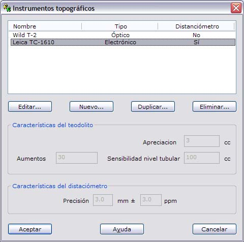

# Instrumentos topográficos
<!-- id: topcal21-otros-comandos-instrumentos-topograficos-listado-de-instrumentos-topograficos -->

La aplicación permite definir los instrumentos topográficos que se utilizaron para realizar las medidas almacenadas en los ficheros de visuales. De esta forma, al crear un fichero de visuales se podrá indicar con qué instrumental fueron realizadas. Esto permitirá al programa saber con qué precisión se hicieron las medidas y cuando, en algún cálculo, deba ponderar las visuales utilizará la precisión del aparato que se utilizó. Por ejemplo, cuando se utilizan mínimos cuadrados para calcular coordenadas es normal ponderar las visuales inversamente proporcional a la precisión que estas tienen. Dicha precisión será función de las características de la propia visual y a la precisión del instrumental utilizado.

Estas definiciones se almacenan en un fichero que se encuentra en la misma carpeta donde está el fichero ejecutable y que se denomina **Instrumentos.dat**.

El programa muestra los instrumentales almacenados mediante un cuadro de diálogo, donde aparecen lo siguiente campos:

* **Listado de instrumentos**: Se muestran los diferentes instrumentos almacenados, de tal forma, que se pueden [Editar](instrumento-topografico-nuevo.md), crear uno [Nuevo](instrumento-topografico-nuevo.md), **Duplicar** o **Eliminar** un instrumento existente. En el listado se muestra el nombre del instrumento, si es *Óptico* o *Electrónico* y el tipo de medida de distancias.
* **Características del teodolito**: En este apartado se muestran las características del teodolito del instrumental seleccionado en la lista. Estas características están compuestas por la *Apreciación*, los *Aumentos* y la *Sensibilidad del nivel tubular*.
* **Características del distanciómetro**: En este apartado se muestran las características del distanciómetro del instrumental seleccionado en la lista, si tiene. Estas características se resumen en la *precisión* del propio distanciómetro.
