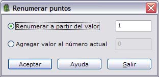

# Renumerar puntos
<!-- id: renumerar-puntos -->

Esta herramienta sirve para renumerar los puntos del fichero actual respetando el orden que actualmente se tenga. El programa da dos opciones para esta operación:

* **Renumerar a partir del valor**: El programa renumera todos los puntos a partir del valor indicado.
* **Agregar valor al número actual**: El programa añade el valor indicado al número que actualmente tengan los puntos.
