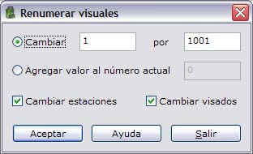

# Renumerar visuales
<!-- id: renumerar-visuales -->

Esta herramienta sirve para modificar los números de estación y de punto visado de las visuales del fichero actual, respetando el orden que actualmente tienen. El programa da dos opciones para esta operación:

* **Cambiar**: Sustituye el número indicado por el número nuevo en las visuales cuyo número de estación o de punto visado coincide con el número indicado, según las casillas **Cambiar estaciones** y **Cambiar visados**.
* **Agregar valor al número actual**: Suma el valor indicado al número de estación o de punto visado de las visuales, según las casillas **Cambiar estaciones** y **Cambiar visados**.

Además, el programa permite indicar si se quieren **Cambiar estaciones** y/o **Cambiar visados**.
