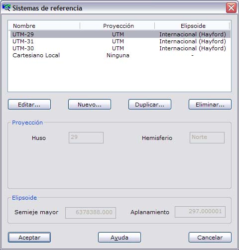

# Sistemas de referencia
<!-- id: topcal21-otros-comandos-sistemas-de-referencia-listado-de-sistemas-de-referencia -->

La aplicación permite crear ficheros de puntos referidos a diferentes sistemas de coordenadas. Para ello, se deben definir previamente los sistemas de referencia que están disponibles para crear los nuevos ficheros de puntos. Esta definición permitirá al programa utilizar determinadas fórmulas en los procesos de cálculo. El programa guarda los sistemas de referencia en el archivo **Sistema de Referencia.dat**, situado en la misma carpeta que el ejecutable.

Desde este cuadro de diálogo el usuario podrá definir los sistemas de referencia que considere adecuados para el trabajo con los ficheros de coordenadas. Debe tener en cuenta que los sistemas de referencia se componen de la elección de una proyección cartográfica y de un elipsoide de referencia. Si el usuario no está utilizando coordenadas en un sistema cartográfico, debido a que el objeto que está midiendo es de dimensiones muy pequeñas, podrá seleccionar un sistema de coordenadas local, donde no es necesario elegir proyección.

En el cuadro de diálogo se muestra un listado con los sistemas de referencia almacenados actualmente y una serie de opciones para operar con ellos. Los campos mostrados son los siguientes:

* **Listado de sistemas de referencia existentes**: Se muestra un listado de los sistemas con su nombre, tipo de proyección y nombre del elipsoide utilizado. Desde aquí podrá [Editar](sistema-de-referencia-nuevo.md), crear [Nuevo](sistema-de-referencia-nuevo.md), **Duplicar** o **Eliminar** un sistema existente.
* **Proyección**: En este apartado se muestran los parámetros de la proyección del sistema seleccionado en la lista. Estos parámetros son función del tipo de proyección seleccionada.
* **Elipsoide**: En este apartado se muestra el semieje mayor del elipsoide y el aplanamiento de éste, perteneciente al sistema seleccionado en la lista.
