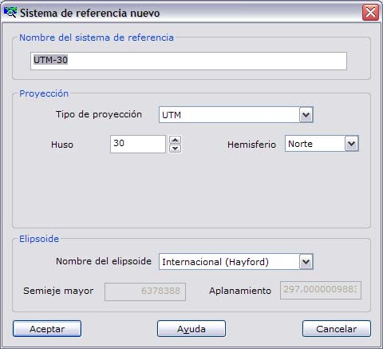

# Sistema de referencia nuevo
<!-- id: sistema-de-referencia-nuevo -->

El sistema de referencia indica al programa qué tipo de coordenadas está utilizando en cada fichero. Es muy importante elegir adecuadamente el sistema de referencia para cada trabajo. El programa no podrá mezclar coordenadas procedentes de diferentes sistemas de referencia en sus cálculos.

Cuando se decide crear o editar un sistema de referencia, la aplicación muestra un cuadro de diálogo, donde se muestran los siguientes parámetros que permitirán al usuario editar el sistema de referencia adecuado para las coordenadas de sus ficheros de puntos:

* **Nombre del sistema de referencia**: Se indicará un nombre único para el sistema creado que ayude a su elección en los listados posteriores. Por tanto, deberá ser referencia de la proyección que contiene en su definición.
* **Proyección**
  * *Tipo de proyección*: Se elegirá el tipo de proyección. Si el tipo de proyección elegido es **Ninguno**, se desactivarán el resto de campos, por entenderse que las coordenadas no responden a ninguna proyección cartográfica. Este es el caso de coordenadas locales. Además, se podrá indicar si se desea que el programa no *reduzca las distancias a la cuerda del elipsoide*. Las proyecciones disponibles son UTM, Cónica conforme de Lambert con dos paralelos o Cónica conforme de Lambert con un paralelo.
  * *Parámetros de la proyección*: En función del tipo de proyección seleccionada se activarán unos parámetros u otros para definir la proyección.
    * Para la proyección UTM:
      * Huso
      * Hemisferio
    * Para la proyección Cónica conforme de Lambert con dos paralelos:
      * Longitud origen
      * Latitud origen
      * Falso Este
      * Falso Norte
      * Paralelo 1
      * Paralelo 2
    * Para la proyección Cónica conforme de Lambert con un paralelo:
      * Longitud origen
      * Latitud origen
      * Falso Este
      * Falso Norte
      * Escala
* **Elipsoide**
  * *Nombre del elipsoide*: Se indicará el nombre del elipsoide. Aparece una lista con elipsoides almacenados por defecto en la aplicación o podrá ser definido por el usuario. Si se elige algún elipsoide de la lista, no se podrán editar los valores de la definición del elipsoide.
  * *Semieje mayor*: Valor del semieje mayor del elipsoide en metros.
  * *Aplanamiento*: Valor del denominador que define el aplanamiento del elipsoide.
